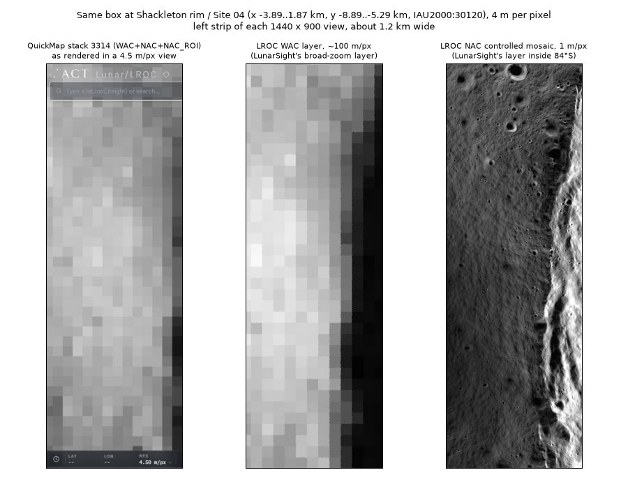
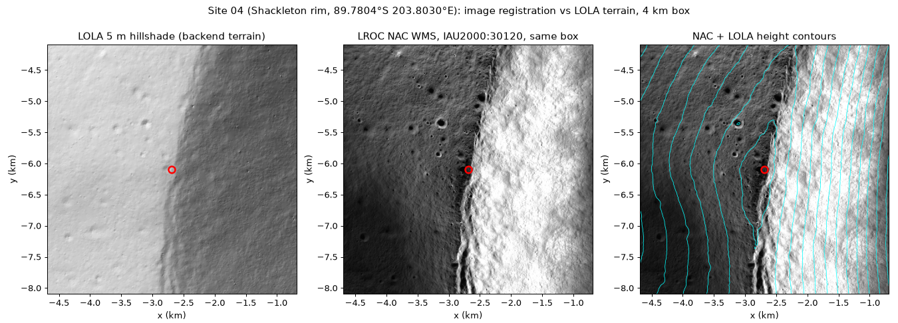

# imagery.md — Lunar Map imagery audit (2026-11-15)

The map's imagery is **visual context only**. Terrain, horizons, visibility and every metric come from the LOLA elevation data in the backend, never from image brightness. Code: `src/frontend/src/imagery.ts`, drawn in `src/frontend/src/MapView.tsx`.

## 1. Why the old map was blurry

**Cause: low-resolution WAC imagery enlarged far beyond its native detail** (cause (b) in the change request). There were no tiles, overlays or CSS blur.

| | Before | Evidence |
|---|---|---|
| Imagery | One bundled image, `src/frontend/src/assets/lroc-south-pole.webp` | `MapView.tsx` drew it with `drawImage`; no other imagery requests |
| Product | LROC WAC South Pole Summer mosaic, the `WAC_ROI_SOUTH_SUMMER_064P` version (64 pixels per degree) | `src/frontend/README.md`, "Basemap provenance" |
| Native resolution | **~474 m/px** (1,408 × 1,408 px over 667 km) | Raster bounds ±333.5 km in `MapView.tsx` |
| CRS | South polar stereographic, sphere R = 1,737.4 km, 0°E up | `polar.ts`; matches pyproj to 0.000 mm (§4) |
| Enlargement | At the default view (~8 screen px per km on a device-pixel-ratio-2 screen) each image pixel covered **~8 device pixels**. At the old maximum zoom (6×), **~50**. | Viewport scale in `MapView.tsx` |
| Max zoom | 6× (about 19 m per screen pixel) | |

The canvas already rendered at the device pixel ratio, so the display itself was not adding blur.

## 2. What QuickMap shows (the reference link)

Read from QuickMap's own configuration (`https://quickmap.lroc.im-ldi.com/maps/lroc`) and from headless renders. I did not judge from appearance alone.

- `stack=3314` is layer **`wac_nac_nacroi`, "WAC+NAC+NAC_ROI_MOSAIC"**. QuickMap describes it as "NAC ROI Mosaics" over "NACs large inc (55 to 80)" over the "WAC Global Morphologic basemap (100 meters/pixel)". It is served by QuickMap's own tile proxy, `lroc-tiles.quickmap.io`.
- `proj=10` in the reference link is **nearside orthographic** (`IAU2000:30166,9001,0,0`), not polar. QuickMap's south-polar view is `proj=27` = **`IAU2000:30120`**.
- **At Shackleton rim / Site 04, at 4.5 m/px, QuickMap's stack 3314 rendered blocky ~100 m WAC pixels**, pixel-for-pixel the same pattern as the Lunaserv WAC layer (figure below). So the reference composite does **not** necessarily show NAC at the pole. I cannot rule out that some NAC tiles hadn't loaded in the headless render's 40 s budget; the comparison is evidence, not proof.

## 3. What the map uses now

Tiles are requested from the **public LROC Lunaserv WMS** (`https://wms.im-ldi.com/`). Its GetCapabilities states **Fees: None, AccessConstraints: None**, and responses carry `Access-Control-Allow-Origin: *`, so the browser loads them directly. There is no proxy and no server-side caching. Tiles are requested **in the map's own projection**, so the browser does no reprojection.

| Layer (order) | WMS layer / product | Native resolution | Coverage | Used at | Citation |
|---|---|---|---|---|---|
| Bundled base (offline fallback, drawn first) | `lroc-south-pole.webp`, WAC_ROI_SOUTH_SUMMER_064P | ~474 m/px | 80–90°S | always | NASA/GSFC/ASU |
| WAC | `luna_wac_roi_south_summer`, LROC WAC South Pole Summer mosaic | **~100 m/px** (measured from pixel blocks; the layer abstract gives no figure) | 45° from the pole | tile levels 0–4 (down to 78 m per tile pixel) | NASA/GSFC/ASU, Speyerer et al. |
| NAC | `luna_nac_pole_control_south`, **controlled 1 m/px south-pole average mosaic** (= NAC_POLE_SOUTH_CM_AVG) | **1 m/px** | **84–90°S** (controlled network 85–90°S) | tile levels 4–11 (78 m down to 0.61 m per tile pixel) | NASA/GSFC/ASU; Archinal et al. (2023), LPSC 54 #2333 |

- **CRS: `IAU2000:30120`** (Moon south-polar stereographic). The NAC product is documented as "Stereographic projection at 1 meter/px centered at 90S, 0E with a radius of 1737400 m", identical to `polar.ts`.
  - **Pitfall found:** `IAU2000:30118` is the *north*-polar projection. Requesting the south pole in it returns blank 1.2 KB tiles with HTTP 200.
- **Tiles:** a quadtree over ±320 km; 512 px tiles; the level is chosen so one tile pixel is at most one device pixel.
  - Coarser levels stay underneath while finer tiles load.
  - NAC tiles that straddle 84°S are PNG with transparency, so the WAC layer shows outside NAC coverage.
  - At most 6 requests are in flight, and up to 600 tiles are cached in memory.
  - **Speed:** tiles are requested only after the view has been still for 150 ms, so zoom levels merely passed through are never downloaded. Downloads for tiles that left the view are cancelled. 512 px tiles render in about the same time as 256 px ones (measured 3.4–3.7 s vs 2.6–3.4 s), so each request covers 4× the area. The server renders every tile on request (a repeat request still took 1.2 s), so the remaining wait is that render time.
- **HD toggle (off by default):** the map normally shows only the bundled single image, so zooming is instant and makes no network requests. The **HD** button under the zoom controls turns the LROC tiles on; switching it off cancels any downloads in progress. Tiles already loaded stay cached, so switching back on shows them at once.
- **Honest fallback:** the map key states the imagery under the view centre and its native resolution. It adds "(enlarged beyond native detail)" when the view zooms past it: past 1 m/px for NAC, 100 m/px for WAC, and 474 m/px for the offline base.
- **Zoom:** the maximum zoom went from 6× to 250×, enough to reach NAC's 1 m pixels. The mouse wheel now zooms about the cursor.

**Example request** (captured in the running app with the original 256 px tiles, Site 04 area):
`https://wms.im-ldi.com/?SERVICE=WMS&VERSION=1.1.1&REQUEST=GetMap&STYLES=&SRS=IAU2000:30120&LAYERS=luna_nac_pole_control_south&BBOX=-10000,-10000,0,0&WIDTH=256&HEIGHT=256&FORMAT=image/jpeg` → 200, image/jpeg, typically 1–3.5 s.

**Successive zooms at −89.92°, 23.45°E** fetched NAC tiles at **39.1 → 19.5 → 4.9 → 2.4 → 0.61 m per tile pixel** (80, 7, 48, 6 and 16 tiles respectively; measured with the original 256 px tiles, before the speed changes). The label changed to "enlarged beyond native detail" only past 1 m/px.

## 4. Georeferencing checks

- **Projection math:** `polar.ts` `project()` against pyproj (`+proj=stere +lat_0=-90 +lat_ts=-90 +R=1737400`) at 89.92°S 23.45°E, both curated sites, 86.7°S 300°E and 80°S 90°E: **difference 0.000 mm** at every point.
- **Image registration against the backend's terrain:** a NAC tile for a 4 km box around Site 04 lines up with the LOLA 5 m hillshade of the same box. The rim crest and individual small craters coincide, and the Site 04 marker sits on the rim crest in both.

## 5. Caveats

- **NAC average mosaic lighting:** "does not accurately represent any realistic lighting condition" (product description). It shows morphology, not illumination at any time.
- **Permanently shadowed regions** are dark in both mosaics.
- **Between 84°S and 80°S only WAC exists**, so close zooms there are honestly labelled as enlarged.
- **Service dependence:** NAC tiles can take a few seconds each, and the map depends on the LROC service being up. Without it, the bundled 474 m/px base still shows and is labelled as such.
- **Not used:**
  - QuickMap's tile proxy (`lroc-tiles.quickmap.io`): an application endpoint with no published terms.
  - The uncontrolled `luna_nac_sp_mosaic`: a 31 s render in testing.
  - Moon Trek WMTS: not needed once Lunaserv was verified.
