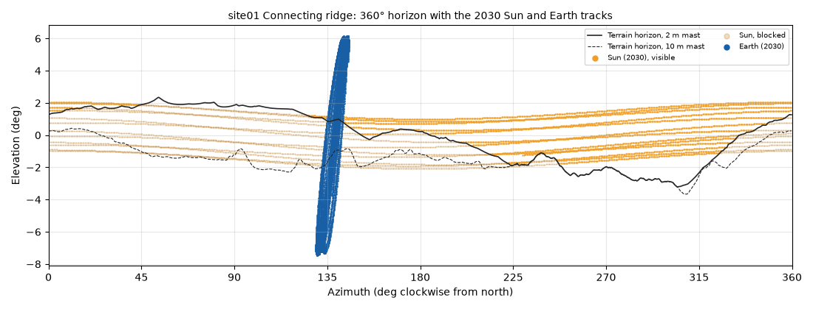
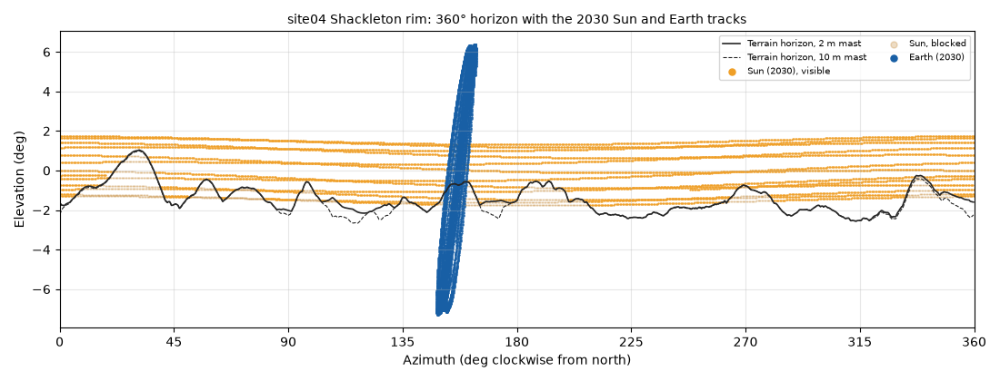

# horizon.md — Terrain horizon and Sun/Earth visibility (M2)

> **Review status: SIGNED OFF (2026-11-14).** Code in `src/backend/app/physics/` and `src/backend/pipeline/build_far_horizons.py`; evidence in §9.1. Any change to this component's behaviour, sampling or stored far fields needs a new review.

## 1. What this component does

It joins the three signed-off foundations into the first real physics result:

```text
P3 terrain ──► horizon profile H(azimuth; observer height)  ──┐
                                                                 ├─► visibility per time step ──► metrics + feasibility
P2 sky ─────► Sun/Earth azimuth & elevation per time step ────┘
         (P1 frames used throughout)
```

For a site, a mission window and a vehicle, it produces:

1. The **360° terrain horizon** seen from the solar-mast height and from the antenna height: elevation, distance to the blocking terrain, and a no-data flag for each of 1,440 directions.
2. **Sun and Earth visibility** (visible / obstructed / unknown) at every mission time step.
3. The four **P0 metrics** and the feasibility verdict, through the existing metric framework (`docs/metrics.md`).

It is the numerical core only. Wiring it to `/analyze` and the JSON contract is M3.

## 2. The horizon: one ray per direction

For each of **1,440 azimuths** $\theta_i = i \times 0.25^\circ$ (clockwise from north), cast a ray from the site and keep the highest terrain it meets:

1. **Walk the great circle** leaving the site at $\theta_i$ (P1 `great_circle_direction`). The terrain in that vertical plane is exactly what can block a body at that azimuth (`frames.md` §6).
2. At each step, at surface distance $s$, **look up the terrain height** $h_t$ there (P3 lookup) and form the terrain point $(R + h_t)\,\hat{\mathbf{d}}$.
3. **Compute its elevation angle** as seen from the observer (P1 `azimuth_elevation`). The observer sits at the site's ground height plus the vehicle height: $(R + h_\text{ground} + h_\text{obs})\,\hat{\mathbf{u}}$. The azimuth needs no computing: P1 proved a point on the ray is seen at exactly $\theta_i$.
4. The ray's horizon is the **largest elevation** along it, and the distance where that occurred is the **blocking distance**:

$$
H(\theta_i) = \max_{s} \ \alpha(\theta_i, s),
\qquad
s^{*}(\theta_i) = \arg\max_{s} \ \alpha(\theta_i, s)
$$

No small-angle or flat-ground approximation is used anywhere: every sample goes through the exact 3D geometry.

**The edge of the lunar sphere** needs no special handling. The bare sphere's horizon for an observer at height $h$ lies at distance $\sqrt{2Rh}$, at most about 83 km for our highest site plus a 20 m mast. That is inside the 200 km ray, so the sphere's own curvature is already in the samples.

## 3. Sampling: two zones, step = pixel size

| Zone | Distance | Terrain source | Step | Samples per ray |
|---|---|---|---|---|
| Near | 10 m → site's near-field radius (max 8 km; Site 04: 6.3 km) | 5 m site map | **0.5% of distance, max 5 m** (5 cm at 10 m, 0.5 m at 100 m, 5 m from 1 km) | up to ~2,300 |
| Far | near-field radius → 200 km | 40 m regional map | 40 m | up to ~4,800 |

- **Far zone: step = pixel size**, so no terrain pixel is skipped along the ray.
- **Near zone: step grows with distance** *(changed during implementation, see §9.1)*. A height error $\delta h$ at distance $s$ shifts the angle by about $\delta h / s$, so nearby terrain needs much finer sampling than a fixed 5 m. The approved fixed 5 m step failed the step-halving check by up to 0.13°, all from terrain within 250 m.
- **The first 10 m are skipped** (2 pixels) so the observer's own pixel can't block it (`SCIENCE_CONVENTIONS.md` §7).
- That is about 3.3 million near and 6.9 million far samples per site, all vectorized in NumPy.

## 4. Vehicle height: near zone at runtime, far zone precomputed

The far zone is too large to ship (the 40 m map is 882 MB) and doesn't need recomputing for every mast height. So:

- **Far zone, offline, once per site:** cast the far part of every ray from **five observer heights (0, 5, 10, 15, 20 m)**. Store, per height and direction, the **3D position of the highest far terrain point** (plus its distance), and a no-data flag per direction. This is about 300 KB per site: small enough to commit. *(Changed during implementation from a single ground-level point, see below and §9.1.)*
- **Near zone, at runtime, for each requested height:** cast the near part from the 5 m site map, which is shipped.
- **Combining:** for the requested observer height, recompute the elevation of **all five stored far points** exactly from the new observer position, take the highest, then take the larger of near and far in each direction:

$$
H(\theta;\ h_\text{obs}) = \max\Big(H_\text{near}(\theta;\ h_\text{obs}),\ \ \max_{k=1..5}\ \alpha\big(\text{stored far point}_k(\theta)\ \text{seen from}\ h_\text{obs}\big)\Big)
$$

**This refines the plan's analytic correction** ($\Delta\alpha \approx \Delta h \cos^2\alpha / d$, `PROJECT_PLAN.md` §5.3): recomputing from stored 3D points is exact for those points. The remaining risk is that raising the observer makes a *different* far point the highest. With a single ground-level point that happened (measured up to 0.039° at a 20 m mast, against the 0.01° tolerance); storing the highest point for five heights brought it to 0.0000° at every tested height, including heights between the stored ones (§9.1).

Each horizon direction records which zone set it (near or far), for the diagnostics and the contract's proposed blocking distance.

## 5. No-data

A direction is **no-data** if any sample along its ray (near or far) has unknown terrain: a NaN pixel or a point off the map. A missing sample anywhere could hide a higher obstruction, so the whole direction is unknown. P3 found no missing data in any file and full coverage out to 240 km, so with the current data no direction should be no-data; the rule exists for future sites and data.

## 6. Visibility at each time step

For a body (Sun or Earth) at azimuth $a$ and elevation $e$ (P2), interpolate the horizon linearly between the two neighbouring directions, wrapping at $0^\circ/360^\circ$:

$$
V =
\begin{cases}
\text{unknown} & \text{if either neighbouring direction is no-data} \\
\text{visible} & \text{if } e > H(a) \\
\text{obstructed} & \text{otherwise}
\end{cases}
$$

- The **Sun** is compared against the solar-mast horizon, the **Earth** against the antenna horizon.
- The Sun and Earth are treated as points at their centres (approved MVP simplification; partial solar disk is a P1 extension).
- A body exactly on the horizon counts as obstructed.

## 7. From visibility to metrics

The two visibility series go into the existing metric framework unchanged: `sun_visible` and `earth_visible` are placed in the `EvaluationContext` with the mission's time grid, and `DEFAULT_METRICS` plus the constraint rules produce the four metrics, margins and feasibility.

**Dependency:** `docs/metrics.md` §3 (metric definitions) and the rest of §4 (margins, ties, aggregation) are still **pending your review**. M2 uses them as written; please review them alongside this explainer.

## 8. What gets built

| Piece | Where | Runs |
|---|---|---|
| Ray casting (one zone, any terrain grid, any observer height) | `app/physics/horizon.py` | runtime (near) and offline (far) |
| Far-zone precompute | `pipeline/build_far_horizons.py` → `data/horizons/<site>_far.npz` (committed, ~300 KB each) | offline |
| Horizon profile assembly (near + stored far, per height) | `app/physics/horizon.py` | runtime |
| Visibility series | `app/physics/visibility.py` | runtime |
| One-call analysis: site + mission + vehicle + constraints → horizons, sky track, visibility, metrics, feasibility | `app/physics/analysis.py` | runtime, framework-independent (the API calls it in M3) |
| Caching of near horizons by (site, height, data version) | in-process cache | runtime |

## 9. How it will be checked

**Synthetic terrain (exact answers):**

| Check | Expected |
|---|---|
| Smooth sphere, no terrain, observer at height $h$ | $H = -\arccos\big(R / (R+h)\big)$ in every direction (the sphere's own horizon), to the sampling resolution |
| A circular wall of height $W$ at distance $D$ | Elevation of the wall top from exact geometry, in every direction |
| A single ridge in one direction | Raises only the directions crossing it; blocking distance = ridge distance |
| Raising the observer | Never raises the horizon in any direction |
| A NaN pixel on one ray | That direction, and only it, becomes no-data |
| Visibility at a seam ($a$ near $0^\circ/360^\circ$) and exactly on the horizon | Correct interpolation; on-horizon = obstructed |

**Real sites (consistency):**

| Check | Expected / tolerance (proposed) |
|---|---|
| Stored-far-point recompute vs full far recompute, mast heights 0, 2, 10, 20 m | Worst difference **≤ 0.01°** |
| Near/far boundary moved (e.g. 4 km vs the site's radius) | Worst difference **≤ 0.05°** (resolution change in the band between) |
| Halving the step size | Worst difference ≤ 0.01° (sampling has converged); **revised to 0.015°**, see §9.1 |
| Changing the solar-mast height | Earth visibility and Earth horizon unchanged when antenna height is fixed |
| Runtime near-zone cost | Measured; target under 1 s per height per site |
| Results are reproducible | Same inputs → identical outputs |

**Evidence I'll bring back:** test results, the tolerance measurements, 360° horizon plots for all four sites with a year of Sun and Earth tracks overlaid, and each site's yearly sunlight and Earth-visibility fractions.

**Not in M2:** comparison against NASA's published illumination maps (Mazarico et al. 2011) is the next validation step, as planned. M2 checks that the machinery is correct and self-consistent; that step checks it against independent published results.

### 9.1 Evidence (2026-11-14)

**Code.** Runtime: `src/backend/app/physics/horizon.py`, `visibility.py`, `analysis.py`. Offline: `pipeline/build_far_horizons.py` (about 10 s per site), `pipeline/horizon_evidence.py`. Output: `data/horizons/site01…site11_far.npz` (304 KB each, committed).

**Tests.** `tests/test_horizon_synthetic.py` (9 known-answer tests) and `tests/test_horizon_sites.py` (31 checks on the real sites using every 10th direction). Full suite: **183 passed**.

**Synthetic terrain (all pass):**
- Smooth sphere: horizon equals the exact tangent formula $-\arccos\big(R/(R+h)\big)$ to within $2\times10^{-7}$ rad (0.00001°), at the expected distance $\sqrt{2Rh}$.
- Circular wall: elevation within the bounds set by the bilinear edge ramp and step size, in every direction.
- Ridge in one sector: raises only that sector, at the ridge's distance; elsewhere identical to bare terrain.
- Raising the observer never raised the horizon anywhere.
- A single NaN pixel made only the directions crossing it unknown.
- Visibility: interpolation and the 0°/360° wrap, on-horizon = obstructed, next to no-data = unknown.

**Problems found and fixed during implementation:**

| Problem | How it showed up | Fix |
|---|---|---|
| Near-zone rays reached the 5 m map's *edge*, but lookups only work to the outermost pixel *centres* | Unknown samples, so every site's feasibility came out "unknown" (the approved coverage rule working as intended) | Near-field radius measured to pixel centres, minus one pixel for the map's slight scale (P3 build; Site 04 now 6.305 km, others 7.9925 km) |
| Fixed 5 m near step | Step halving changed the horizon by up to 0.13°, all from terrain 50–250 m away | Step = 0.5% of distance, max 5 m (§3) |
| One stored far point per direction | Up to 0.039° error at a 20 m mast | Store the highest far point for five heights (§4) |

**Consistency on all 1,440 directions** (approved tolerances: 0.01°, 0.05°, 0.01°; runtime target 1 s):

| Site | Stored far points vs full recompute (0, 2, 7.5, 12, 20 m) | Boundary moved to 4 km | Step halving | Near zone, 1,440 rays |
|---|---|---|---|---|
| 01 | 0.0000° | 0.0024° | **0.0111°** | 0.77 s |
| 04 | 0.0000° | 0.0316° | **0.0112°** | 0.71 s |
| 07 | 0.0000° | 0.0135° | **0.0124°** | 0.89 s |
| 11 | 0.0000° | 0.0017° | 0.0080° | 0.79 s |

**One tolerance is narrowly missed.** On every 10th direction (the automated test) step halving passes, but on all 1,440 directions the worst case is 0.0124°, against the approved 0.01°. Halving the near step again brings it under 0.01° but pushes the runtime to 1.2–1.45 s. For scale: NASA states a median height uncertainty of 0.3–0.5 m for these 5 m maps, which at 100 m (where these worst cases occur) is 0.17–0.29°, about 20 times larger than this numerical difference. **Decision (2026-11-14): step-halving tolerance is 0.015°** (§11); the automated test uses it.

**Mast and Earth checks:** raising the solar mast left the Earth horizon and Earth visibility bit-for-bit unchanged and never reduced sunlight; analyses are bit-for-bit reproducible; heights outside 0–20 m are rejected.

**What sets each site's horizon** (2 m mast):

| Site | Horizon range | Set by terrain < 1 km away | Near zone ≥ 1 km | Far zone | No-data directions |
|---|---|---|---|---|---|
| 01 | −3.22° to +2.35° | 78% | 0% | 22% | 0 |
| 04 | −2.56° to +1.04° | 17% | 7% | 76% | 0 |
| 07 | −3.15° to +1.28° | 59% | 3% | 38% | 0 |
| 11 | −2.89° to +3.19° | 50% | 0% | 50% | 0 |

**Year 2030, hourly** (no constraints applied):

| Site | Sun visible, 2 m mast | Sun visible, 10 m mast | Longest darkness, 2 m | Longest darkness, 10 m | Earth visible, 2 m | Longest Earth blackout, 2 m |
|---|---|---|---|---|---|---|
| 01 Connecting ridge | 46.8% | 85.0% | 553 h | 152 h | 44.0% | 385 h |
| 04 Shackleton rim | 86.1% | 87.4% | 118 h | 68 h | 53.1% | 326 h |
| 07 Peak near Shackleton | 66.5% | 85.5% | 462 h | 145 h | 57.2% | 300 h |
| 11 de Gerlache rim | 51.8% | 73.9% | 444 h | 176 h | 57.8% | 298 h |

**Reading the results:**
- **Mast height matters enormously at three sites.** Site 01 goes from 47% to 85% sunlight between a 2 m and a 10 m mast, because 78% of its horizon is set by terrain within 1 km: a low mast sits in the shadow of its own ridge. Site 04, on the Shackleton rim crest, is already 86% lit at 2 m because its horizon is set mostly by distant terrain. This is exactly the trade study the tool is meant to show.
- **The same fact is a caution.** Where horizons are set by terrain within ~1 km, results at low masts depend on 5 m terrain that is about 90% interpolated, with 0.3–0.5 m height uncertainty. Quantifying this with NASA's 100 alternative versions of each site map is a natural sensitivity study for later.
- **Site points matter too.** Site 01's point (its DEM centre) sits 14 m below high ground 740 m away, enough to block a Sun that never rises above about 2°. The published "connecting ridge" illumination (Mazarico et al. 2011) refers to the ridge's best points, so expect Site 01 to compare poorly in the validation step unless its point moves to the crest, as Site 04's did.
- Site 04's 86% is in the range reported for the best Shackleton rim locations; the proper comparison against published maps is the next validation step.



*Site 01: at a 2 m mast (solid line) a nearby ridge holds the horizon near +2° from 0° to 135°, blocking the low Sun; at 10 m (dashed) the same horizon drops below 0°. Earth (blue) stays near azimuth 135–145°, swinging ±7° in elevation.*



*Site 04 (Shackleton rim crest): the horizon sits below most of the Sun's track all round.*

Plots for all four sites: `docs/physics/img/horizon_site01.png` … `horizon_site11.png`.

## 10. Assumptions and limits

- Point-source Sun and Earth (§6).
- Terrain is the LOLA data as ingested in P3, including interpolated pixels; small features below 5 m (near) or 40 m (far) resolution are not represented.
- Far-zone horizon precomputed at five observer heights and recomputed exactly per height (§4), within the measured tolerance.
- Horizons set by terrain within about 1 km depend on interpolated 5 m terrain with 0.3–0.5 m height uncertainty (§9.1); low-mast results there carry correspondingly more uncertainty.
- Observer heights bounded (proposed 0–20 m) so the stored far points stay valid; the API will enforce this in M3.
- 200 km ray length (`PROJECT_PLAN.md` §5.2).

## 11. Review sign-off

| Stage | Reviewer | Date | Decision / comments |
|---|---|---|---|
| Approach (§2–§8), incl. tolerances in §9 and the 0–20 m height range | Randy Moore | 2026-11-14 | Approved |
| Implementation changes (§3 near step, §4 five far heights, near-field radius correction in `terrain.md` §7) | Randy Moore | 2026-11-14 | Accepted |
| Step-halving tolerance 0.01° → 0.015° (§9.1) | Randy Moore | 2026-11-14 | Accepted |
| Implementation and evidence (§9) | Randy Moore | 2026-11-14 | Signed off |
