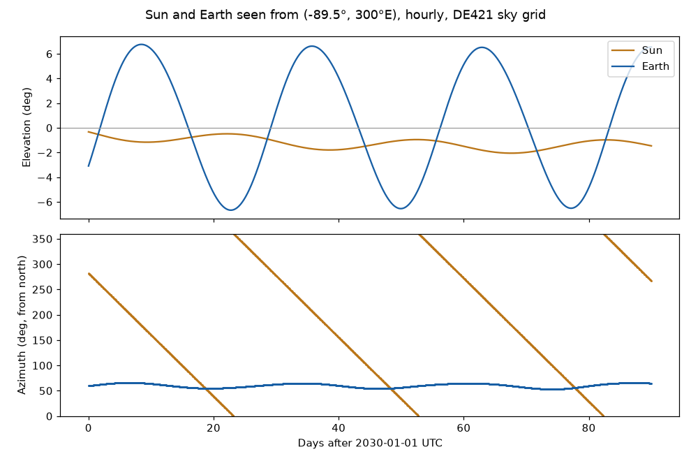

# sky.md — Sun and Earth directions over time (P2)

> **Review status: SIGNED OFF (2026-11-14).** Offline pipeline `src/backend/pipeline/build_sky_grid.py`, runtime module `src/backend/app/astronomy/sky.py`, evidence in §7.1. Any change to this component's behaviour, kernels or grid needs a new review.

## 1. What this component does

For a site and a mission window, produce the **azimuth and elevation of the Sun and the Earth** at every sample time, as seen from the site. Later, M2 compares these against the terrain horizon to decide visibility.

It works in two stages (`PROJECT_PLAN.md` §8.1):

| Stage | Where | What |
|---|---|---|
| **Sky grid** | Offline script, uses SPICE | Sun and Earth position vectors **from the Moon's center**, in `MOON_ME`, every hour over 2026–2040. Saved to one file. |
| **Topocentric conversion** | Runtime server, NumPy only | Subtract the site's position, then convert to azimuth/elevation with the P1 `LocalFrame`. |

The grid is the same for every site, so adding a site never requires re-running SPICE.

## 2. Ephemeris: DE421

A **JPL Development Ephemeris (DE)** is JPL's numerical model of where the Sun, Moon and planets are, and how the Moon is oriented, fitted to decades of observations (radar, spacecraft tracking, lunar laser ranging) and integrated over a span of years. "421" is the version, released in 2008. NAIF publishes it as SPICE kernels.

| Kernel | Role | Size |
|---|---|---|
| `naif0012.tls` | Leap seconds, for UTC ↔ TDB conversion | 5 KB |
| `de421.bsp` | Positions of Sun, Earth, Moon and planets | 16.8 MB |
| `moon_pa_de421_1900-2050.bpc` | Moon's orientation (its "principal axis" frame) over time | 1.8 MB |
| `moon_080317.tf` | Defines `MOON_ME` relative to the DE421 principal-axis frame | 21 KB |
| `moon_assoc_me.tf` | Tells SPICE to use `MOON_ME` as the Moon's body-fixed frame | 8 KB |

**Why DE421 rather than the newer DE440:** the LOLA terrain data is published in `MOON_ME` *as realized by DE421*. Using the same realization means terrain and Sun/Earth directions share exactly one frame, with no offset to estimate or document. The frame kernel confirms `MOON_ME` is defined relative to `MOON_ME_DE421`. DE421 covers 1900–2050, which contains 2026–2040.

The files are downloaded (2026-11-14), stored in `data/kernels/` (gitignored), and listed with SHA-256 checksums in `data/manifests/kernels.json`.

## 3. Time

| Item | Choice |
|---|---|
| Grid times | Every whole hour in **UTC**, from `2026-01-01T00:00:00Z` up to but not including `2041-01-01T00:00:00Z` (131,496 samples) |
| Conversion | Each UTC instant is converted to SPICE ephemeris time (TDB seconds past J2000) with `str2et`, using the leapseconds kernel |
| Mission alignment | A mission's start must be on a whole UTC hour and its step a whole number of hours, so every sample lands exactly on a grid time. No interpolation is ever needed. |

**Future leap seconds.** `naif0012.tls` contains every leap second announced so far. If a new one is added before 2040, our UTC ↔ TDB mapping after that date would be off by 1 s. The Sun moves about $0.5^\circ$ per hour across the polar sky, so 1 s shifts it by about $0.00014^\circ$: negligible.

## 4. The sky grid (offline)

For each grid time $t$, SPICE returns the position of each body relative to the Moon's center, expressed in `MOON_ME` at that instant:

$$
\mathbf{s}(t) = \texttt{spkpos}(\text{SUN},\ t,\ \text{MOON\_ME},\ \text{LT+S},\ \text{MOON}),
\qquad
\mathbf{g}(t) = \texttt{spkpos}(\text{EARTH},\ t,\ \text{MOON\_ME},\ \text{LT+S},\ \text{MOON})
$$

**Aberration correction `LT+S`** gives the *apparent* direction: where the body appears, not where it is at that instant.
- **LT (light time):** we see the Sun as it was about 8.3 minutes earlier, and the Earth about 1.3 s earlier.
- **S (stellar aberration):** the Moon's own motion around the Sun tilts the apparent direction by up to about $20''$ ($0.006^\circ$).

**Stored file** (`data/sky/sky_grid_de421_2026_2040_1h.npz`, committed to the repo; also stores `et_tdb_s`, the TDB time of each sample, for validation):

| Array | Shape | Units |
|---|---|---|
| `utc_start`, `step_s` | scalars | ISO string, seconds |
| `sun_m` | $(131496, 3)$ | metres, MOON_ME, from Moon center |
| `earth_m` | $(131496, 3)$ | metres, MOON_ME, from Moon center |
| provenance | text | kernel names and checksums, script version |

Size: 7.4 MB including `et_tdb_s`. If that's too large to commit comfortably it can go to a release asset like the terrain files.

## 5. From the grid to a site (runtime)

For a site at Moon-fixed position $\mathbf{p}$ (P1, `site_to_position`), the vector from the **site** to each body is

$$
\mathbf{r}_\text{Sun}(t) = \mathbf{s}(t) - \mathbf{p},
\qquad
\mathbf{r}_\text{Earth}(t) = \mathbf{g}(t) - \mathbf{p}
$$

Azimuth and elevation then come from the P1 `LocalFrame.azimuth_elevation`, which already performs exactly this subtraction.

**Why this is accurate.** The subtraction is the exact geometric change of viewpoint, so it fully captures Earth's parallax (about $0.26^\circ$, since $1737.4 / 384{,}400 \approx 0.0045$ rad). What it doesn't redo is the light-time and aberration correction for the site instead of the center:

| Neglected effect | Size | Effect on direction (measured in §7.1) |
|---|---|---|
| Light time from site vs center | at most $1737\ \text{km} / c \approx 5.8\ \text{ms}$ | Earth: $3\times10^{-6}$ degrees |
| Stellar aberration applied to the center-based vector, then shifted to the site (instead of applied to the site's own vector) | aberration moves the apparent Earth by a few arcseconds | Earth: $2.7\times10^{-5}$ degrees ($0.1''$); Sun: $10^{-7}$ degrees |
| Stellar aberration from the site's own rotation speed | site moves at most about 4.6 m/s (equator) | $\sim 10^{-6}$ degrees |

All are far below anything that matters (the approved tolerance is $0.001^\circ$). The second row was **not** in the original approach and was found during implementation; see §7.1.

## 6. What it produces

For each mission sample: Sun azimuth, Sun elevation, Earth azimuth, Earth elevation (radians internally, degrees in the API), plus the UTC timestamp. Visibility is *not* decided here; that needs the horizon (M2).

## 7. How it will be checked

**1. Method check against SPICE at the site (automated test).** For several sites and many times, compare our grid-plus-subtraction result with SPICE computing the apparent direction from the site itself (`spkcpo`, observer fixed in `MOON_ME`, same `LT+S`). **Proposed tolerance: $0.001^\circ$.** §5 predicts agreement around $10^{-6}$ degrees.

**2. Independent cross-check against JPL Horizons.** For 3–5 times at 2 test locations, request apparent azimuth/elevation of the Sun and Earth from Horizons for an observer on the lunar surface (body 301). Horizons uses its own ephemeris version and lunar model, so small differences are expected. **Proposed tolerance: $0.01^\circ$**; anything larger gets investigated and explained, not tuned away. This queries `ssd.jpl.nasa.gov` from the offline script, sending only the test coordinates and times.

**3. Physical sanity checks** (over a full year at a polar test location):

| Check | Expected |
|---|---|
| Sun elevation at latitude $-89.5^\circ$ | Stays within about $\pm 2^\circ$ (the Sun's $\pm 1.5^\circ$ seasonal swing plus the $0.5^\circ$ distance from the pole) |
| Sun azimuth | Goes once around the sky per synodic month, about 29.5 days |
| Earth elevation | Stays within a few degrees of the horizon, wobbling with the Moon's libration (about $\pm 7^\circ$ in latitude) |
| Earth azimuth | Wobbles back and forth; does **not** go all the way round |
| Distances | Sun about 1 AU; Earth between about 356,000 and 407,000 km |

**4. Grid file integrity.** Times strictly hourly, no gaps, checksums recorded, loads to the documented shapes.

**Test locations.** P2 doesn't need the demo sites: the grid is site-independent, and the checks only need realistic polar positions, e.g. $(-89.5^\circ, 300^\circ)$ and $(-85^\circ, 10^\circ)$. The demo sites' exact coordinates will be read from the terrain GeoTIFF headers in P3. (NASA's site pages name the sites but don't list coordinates.)

**Evidence I'll bring back:** test results, the Horizons comparison table, and plots of Sun and Earth elevation/azimuth over a few months at one test location.

### 7.1 Evidence (2026-11-14)

**Code.** Offline: `src/backend/pipeline/build_sky_grid.py` (run as `python -m pipeline.build_sky_grid`), `pipeline/spice_kernels.py` (checksum-verified kernel loading), `pipeline/horizons_check.py`, `pipeline/sky_evidence.py`. Runtime: `src/backend/app/astronomy/sky.py`. The grid file `data/sky/sky_grid_de421_2026_2040_1h.npz` is 7.4 MB (131,496 samples) and took under 4 s to build.

**Tests.** `tests/test_sky_runtime.py` (12 tests on synthetic grids: alignment and range rules, zenith, the parallax subtraction, timestamps) and `tests/test_sky_spice.py` (10 tests against the real grid and SPICE; skipped automatically where kernels aren't installed). Full suite: 117 passed.

**Check 1: grid method vs SPICE computed at the site.** 2,000 random grid times per row, `spkcpo` with the observer fixed in MOON_ME, same `LT+S`. Tolerance $0.001^\circ$.

| Site (lat, lon) | Body | Worst difference |
|---|---|---|
| $-89.5^\circ$, $300^\circ$ | Sun | $1.1\times10^{-8}$ degrees |
| $-89.5^\circ$, $300^\circ$ | Earth | $2.7\times10^{-5}$ degrees |
| $-85^\circ$, $10^\circ$ | Sun | $8.5\times10^{-8}$ degrees |
| $-85^\circ$, $10^\circ$ | Earth | $2.7\times10^{-5}$ degrees |
| $-89.9^\circ$, $123.4^\circ$ | Sun | $4.6\times10^{-9}$ degrees |
| $-89.9^\circ$, $123.4^\circ$ | Earth | $2.7\times10^{-5}$ degrees |

**Investigating the Earth residual.** It was 25× larger than §5 originally predicted, so it was traced by switching corrections one at a time (300 times, 2027–2040):

| Aberration correction | Worst Earth difference |
|---|---|
| None (pure geometry) | $0$: the site subtraction is exact |
| Light time only | $3.1\times10^{-6}$ degrees |
| Light time + stellar aberration | $2.7\times10^{-5}$ degrees |

So the residual is the order of operations for stellar aberration, now listed in §5. It is $0.1''$, 37× inside the tolerance, and far below the terrain-horizon uncertainty that will dominate visibility. No change to the method is needed.

**Check 2: JPL Horizons** (independent: DE441, Horizons' own `MEAN_ME` and 1737.4 km sphere, airless apparent az/el). Tolerance $0.01^\circ$. Worst on-sky difference: **$0.00003^\circ$**.

| Site | Body | Time (UTC) | Horizons az / el | Ours az / el | Δaz | Δel |
|---|---|---|---|---|---|---|
| $-89.5^\circ$, $300^\circ$ | Sun | 2027-03-01 00:00 | 325.5141° / −0.1578° | 325.5141° / −0.1578° | −0.00000° | +0.00001° |
| $-89.5^\circ$, $300^\circ$ | Sun | 2030-06-15 12:00 | 65.0421° / +0.4408° | 65.0421° / +0.4408° | −0.00000° | +0.00001° |
| $-89.5^\circ$, $300^\circ$ | Sun | 2033-09-30 06:00 | 159.9801° / −0.3014° | 159.9801° / −0.3014° | −0.00001° | −0.00000° |
| $-89.5^\circ$, $300^\circ$ | Sun | 2039-12-01 18:00 | 49.1355° / +0.2385° | 49.1355° / +0.2385° | −0.00001° | +0.00001° |
| $-89.5^\circ$, $300^\circ$ | Earth | 2027-03-01 00:00 | 64.0138° / −6.0323° | 64.0138° / −6.0322° | −0.00000° | +0.00003° |
| $-89.5^\circ$, $300^\circ$ | Earth | 2030-06-15 12:00 | 61.1080° / +0.4744° | 61.1080° / +0.4744° | −0.00000° | +0.00000° |
| $-89.5^\circ$, $300^\circ$ | Earth | 2033-09-30 06:00 | 53.2915° / +6.4103° | 53.2915° / +6.4103° | −0.00001° | −0.00002° |
| $-89.5^\circ$, $300^\circ$ | Earth | 2039-12-01 18:00 | 60.4462° / +0.9404° | 60.4462° / +0.9404° | −0.00001° | +0.00002° |
| $-85^\circ$, $10^\circ$ | Sun | 2027-03-01 00:00 | 255.6132° / −1.8173° | 255.6132° / −1.8173° | −0.00000° | +0.00001° |
| $-85^\circ$, $10^\circ$ | Sun | 2030-06-15 12:00 | 355.0188° / +5.2110° | 355.0188° / +5.2110° | −0.00000° | +0.00001° |
| $-85^\circ$, $10^\circ$ | Sun | 2033-09-30 06:00 | 89.9951° / +0.1695° | 89.9951° / +0.1695° | −0.00001° | −0.00000° |
| $-85^\circ$, $10^\circ$ | Sun | 2039-12-01 18:00 | 339.0650° / +4.5827° | 339.0650° / +4.5827° | −0.00001° | +0.00001° |
| $-85^\circ$, $10^\circ$ | Earth | 2027-03-01 00:00 | 354.0920° / −1.2791° | 354.0920° / −1.2791° | −0.00001° | +0.00003° |
| $-85^\circ$, $10^\circ$ | Earth | 2030-06-15 12:00 | 351.0628° / +5.1735° | 351.0628° / +5.1735° | −0.00000° | +0.00000° |
| $-85^\circ$, $10^\circ$ | Earth | 2033-09-30 06:00 | 343.0222° / +10.8994° | 343.0222° / +10.8994° | −0.00001° | −0.00002° |
| $-85^\circ$, $10^\circ$ | Earth | 2039-12-01 18:00 | 350.3885° / +5.6251° | 350.3885° / +5.6251° | −0.00001° | +0.00002° |

Agreement this close despite the different ephemeris version (DE441 vs DE421) shows the two lunar frame realizations differ negligibly for this purpose.

**Check 3: physical sanity** (test location $-89.5^\circ$, $300^\circ$, hourly through 2030; distances over the whole grid):

| Check | Expected | Measured |
|---|---|---|
| Sun elevation range | within about $\pm 2^\circ$ | $-2.05^\circ$ to $+2.02^\circ$ |
| Sun azimuth turns per year | $365 / 29.53 = 12.36$ | $12.36$ |
| Earth elevation range | within a few degrees (libration) | $-6.79^\circ$ to $+6.77^\circ$ |
| Earth azimuth span | wobbles, never a full turn | $15.9^\circ$ |
| Sun distance | about 1 AU | 0.9807 to 1.0193 AU |
| Earth distance | about 356,000 to 407,000 km | 356,445 to 406,677 km |

*Sun and Earth over the first 90 days of 2030 at $(-89.5^\circ, 300^\circ)$. The Sun circles the sky once per month while staying within $2^\circ$ of the horizon (mostly just below it here: southern winter). Earth's elevation swings $\pm 6.8^\circ$ with the Moon's roughly 27-day libration while its azimuth only wobbles between about $55^\circ$ and $65^\circ$.*

**Check 4: grid integrity.** 131,496 samples from 2026-01-01T00:00Z to 2040-12-31T23:00Z; consecutive times differ by 3600 s of TDB to within 10 ms (the periodic TDB−TT term); kernel checksums recorded in the file's provenance.

## 8. Assumptions and limits

- **Body centers.** Directions are to the centers of the Sun and Earth. The Sun's disk radius (about $0.27^\circ$) is handled later as a P1-priority partial-disk refinement, not here.
- **No refraction.** The Moon has no atmosphere.
- **DE421 accuracy** for 2026–2040 is far better than our needs; its lunar orientation is accurate to well under an arcsecond for this purpose.
- **Future leap seconds** as discussed in §3.
- **Supported dates** are limited to the grid: requests outside 2026–2040 are rejected with a documented error.
- **Offline dependencies.** The grid script needs `spiceypy`; it goes in a separate "pipeline" dependency group so the hosted server never installs it.

## 9. Review sign-off

| Stage | Reviewer | Date | Decision / comments |
|---|---|---|---|
| Approach (§2–§6), incl. tolerances in §7 | Randy Moore | 2026-11-14 | Approved (0.001° SPICE method check, 0.01° Horizons check, whole-hour mission alignment) |
| Implementation and evidence (§7) | Randy Moore | 2026-11-14 | Signed off, incl. the stellar-aberration residual found during implementation (§5, §7.1) |
