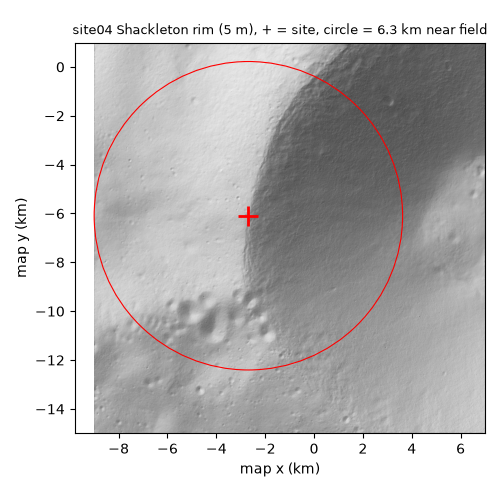
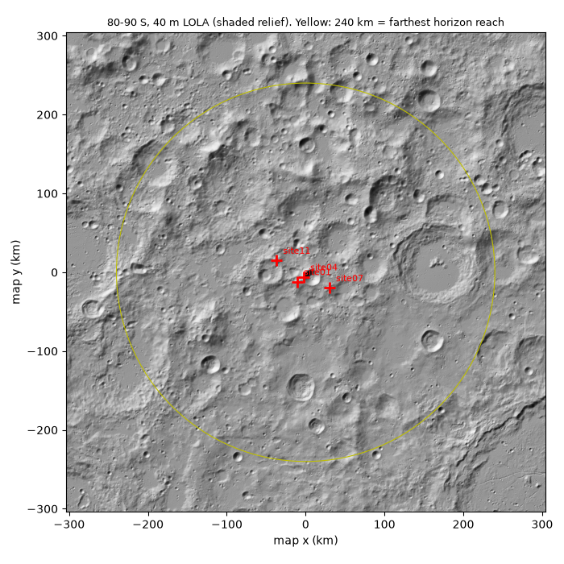

# terrain.md — Terrain ingest (P3)

> **Review status: SIGNED OFF (2026-11-14).** Runtime code in `src/backend/app/terrain/`, offline build in `src/backend/pipeline/build_terrain.py`, evidence in §8.1. Any change to this component's behaviour, source files or site points needs a new review.

## 1. What this component does

It turns NASA's LOLA terrain maps into something the horizon calculation (M2) can use:

1. **Look up terrain height at any lat/lon** in the south-polar region, with missing data reported as unknown.
2. **Prepare per-site terrain files**: a detailed 5 m map around each demo site (shipped to the server) and a 40 m map of the wider region (used offline to precompute each site's distant horizon).
3. **Fix each demo site's coordinates and ground height.**

It does **not** compute horizons; that's M2.

## 2. Source data (downloaded and inspected 2026-11-14)

Nine files, 1.04 GB, in `data/raw/terrain/` (gitignored), with SHA-256 checksums in `data/manifests/terrain.json`. Values below are read from the files' own metadata, not from memory.

| File(s) | Coverage | Grid | Pixel | Heights (range seen) |
|---|---|---|---|---|
| `Site01/04/07/11_final_adj_5mpp_surf.tif` | 16 × 16 km around each site | 3200 × 3200 | 5 m | Site 04: −2,847 to +1,804 m |
| `…_5mpp_ldec.tif` (same sites) | Same | Same | 5 m | LOLA measurement counts per pixel, 0 to 5 |
| `LDEM_80S_40MPP_ADJ.TIF` | 80–90°S (±304 km square) | 15200 × 15200 | 40 m | −7,254 to +7,007 m |

**Common to every file:**

| Property | Value |
|---|---|
| Projection | South polar stereographic: `+proj=stere +lat_0=-90 +lat_ts=-90 +lon_0=0 +R=1737400` |
| Body shape | Sphere, radius **1,737,400 m**, identical to our reference sphere (P1) |
| Values | 32-bit float, metres |
| Missing data | NaN; **none found** in any file |
| Pixel registration | Pixel-registered: grid coordinates are pixel centres; file bounds are pixel edges |

## 3. The map projection

Polar stereographic maps the south-polar region onto a flat grid by projecting from the north pole. For a point at latitude $\varphi$ and east longitude $\lambda$, its distance from the south pole on the map and its map coordinates are

$$
\rho = 2R\,\tan\left(\frac{\pi}{4} + \frac{\varphi}{2}\right),
\qquad
x = \rho \sin\lambda,
\qquad
y = \rho\cos\lambda
$$

and the inverse is

$$
\lambda = \operatorname{atan2}(x,\ y),
\qquad
\varphi = 2\arctan\left(\frac{\sqrt{x^2+y^2}}{2R}\right) - \frac{\pi}{2}
$$

**Check against the data:** at $\varphi = -80^\circ$, $\rho = 2 \times 1737.4\ \text{km} \times \tan 5^\circ = 304.0\ \text{km}$, exactly the half-width of the 40 m map. And Site 04's centre $(x, y) = (-1, -7)\ \text{km}$ gives $\lambda = \operatorname{atan2}(-1, -7) = 188.13^\circ$, matching pyproj.

**Scale.** The map stretches distances by $k = 2 / (1 - \sin\varphi)$: exactly 1 at the pole, 1.0001 at $88.7^\circ$S, 1.0077 at $80^\circ$S. The geometry never relies on map distances: every terrain sample is converted back to lat/lon and then to a 3D position (P1), so this stretch doesn't affect any angle.

**Implementation.** The runtime server must stay NumPy-only (`PROJECT_PLAN.md` §8.1), so these two closed-form formulas are implemented directly in NumPy and tested against pyproj (§8). pyproj and rasterio are used only offline.

## 4. Height reference

Heights are treated as **metres above the 1,737.4 km sphere**, so a terrain point's 3D position is $(R + h)\,\hat{\mathbf{d}}$ (P1).

Evidence: the files' coordinate system declares that sphere; this is LOLA's standard height convention; and §8 cross-checks the 5 m and 40 m products against each other at the same locations. A systematic offset between them would reveal a datum mismatch.

## 5. Looking up height at a point

1. Convert lat/lon to map $(x, y)$ with §3.
2. Convert to fractional pixel indices using the grid's origin and pixel size, remembering that pixel centres sit half a pixel inside the file bounds.
3. **Bilinear interpolation** between the four surrounding pixel centres.
4. **Unknown rules:** if any of the four pixels is NaN, or the point falls outside the grid, the height is **unknown (NaN)**, never zero and never "low terrain". M2 turns that into "unknown" visibility, matching `docs/metrics.md` §3.2.

## 6. Demo sites

NASA's site pages don't list coordinates. The approved approach used **the centre of each site's 5 m DEM**. Implementation showed that this is not always the analysed site: **Site 04's DEM centre lies on Shackleton's inner crater wall** (33° slope, 770 m; §8.1). So site points are chosen by one of two documented rules:

| Rule | Used for | Definition |
|---|---|---|
| DEM centre | Sites 01, 07, 11 | The centre of the 16 × 16 km DEM |
| Rim crest | Site 04 (approved 2026-11-14) | The highest 5 m pixel within 2 km of the DEM centre |

Resulting sites (written by the build to `data/sites/south_pole_sites.json`):

| Site | Name (Mazarico et al. 2011 numbering) | Latitude | Longitude (E) | Ground height | Rule |
|---|---|---|---|---|---|
| 01 | Connecting ridge | $-89.463163^\circ$ | $222.510447^\circ$ | 1,945 m | DEM centre |
| 04 | Shackleton rim | $-89.780403^\circ$ | $203.803049^\circ$ | 1,739 m | Rim crest |
| 07 | Peak near Shackleton | $-88.811008^\circ$ | $123.690068^\circ$ | 1,645 m | DEM centre |
| 11 | de Gerlache rim | $-88.683418^\circ$ | $292.067900^\circ$ | 1,794 m | DEM centre |

Each site's ground height is the §5 lookup at that point. All four are far enough from the pole for the P1 pole guard. The 200 km horizon radius from the farthest site reaches at most 240 km from the pole, inside the 40 m map's 304 km, so **the whole horizon of every site is covered by data**.

**Caveat:** these are well-defined, reproducible points on the named features, not necessarily the exact spots Mazarico et al. analysed. If the paper's coordinates become available, we should use those instead.

## 7. What gets built

| Output | Contents | Where | Size |
|---|---|---|---|
| Per-site detailed terrain | The 16 × 16 km 5 m height grid as `.npy`, plus its grid origin, pixel size and provenance | `data/artifacts/terrain/<site>/` (gitignored; shipped later as release assets) | 41 MB per site, 164 MB for four |
| Regional terrain | The 40 m map converted to `.npy` for fast offline sampling | `data/artifacts/terrain/region_80s_40m/` (offline only, never shipped) | ~924 MB |
| Site list | The §6 table plus ground heights | `data/sites/south_pole_sites.json` (committed) | tiny |

**The nearby/distant boundary is set per site, at most 8 km.** It is the largest radius fully covered by 5 m data in every direction around the site point, capped at 8 km (previously "~10 km, tunable"). Sites at their DEM centre get 8 km; Site 04, moved 1.9 km off-centre to the rim crest, gets **6.31 km**. The height correction for distant terrain at 8 km is about $0.07^\circ$ for a 10 m mast (about $0.09^\circ$ at 6.3 km), handled analytically as planned (`PROJECT_PLAN.md` §5.3). Each site's radius is stored in the site list as `near_field_radius_m`.

**Code:**
- `app/terrain/` (runtime, NumPy only): the projection formulas, a grid class (origin, pixel size, heights) and the bilinear lookup with the unknown rules.
- `pipeline/build_terrain.py` (offline): verifies checksums, reads the GeoTIFFs with rasterio, **checks that each file's projection exactly matches §2** (refusing anything else), and writes the outputs above.

## 8. How it will be checked

| Check | Expected |
|---|---|
| NumPy projection vs pyproj, thousands of points over 80–90°S, both directions | Agree to within 1 mm |
| $\rho(-80^\circ)$ | 304.0 km = map half-width |
| Bilinear lookup at a pixel centre | Exactly that pixel's value |
| Bilinear lookup on a synthetic tilted plane | Reproduces the plane exactly |
| Point outside the grid, or next to an injected NaN | Unknown (NaN) |
| Our lookup vs rasterio's own sampling at random pixel centres in the real files | Identical values (confirms half-pixel registration is handled right) |
| **5 m vs 40 m consistency:** average the 5 m map into 40 m blocks and compare with the 40 m map over each site | Mean difference near 0 (same height datum); spread of a few metres from resolution |
| Whole-file scan | NaN count 0 (confirming the sampled result in §2) |
| Visual check | Shaded-relief images of each site and of the 40 m region, for you to compare against LROC QuickMap |

**Evidence I'll bring back:** the test results, the 5 m vs 40 m comparison table, the site table with ground heights, and the shaded-relief images.

### 8.1 Evidence (2026-11-14)

**Code.** Runtime: `src/backend/app/terrain/grid.py` (projection, `TerrainGrid`, bilinear lookup; NumPy only). Offline: `src/backend/pipeline/build_terrain.py` (verifies checksums via `pipeline/checksums.py`, refuses unexpected projections or grids, writes artifacts and the site list in about 5 s) and `pipeline/terrain_evidence.py`. Outputs: 4 site grids of 40 MB each and the 882 MB regional grid in `data/artifacts/terrain/` (gitignored), and `data/sites/south_pole_sites.json` (committed).

**Tests.** `tests/test_terrain_grid.py` (11 synthetic tests) and `tests/test_terrain_data.py` (15 tests against the real files, including the near-field circle lying inside the 5 m map and the Site 04 rim-crest check; skipped where artifacts aren't built). Full suite: 143 passed.

| Check | Expected | Result |
|---|---|---|
| NumPy projection vs pyproj, 100,000 points over 80–90°S | within 1 mm | forward $7\times10^{-7}$ mm, inverse $4\times10^{-7}$ mm |
| $\rho(-80^\circ)$ | 304.0 km map half-width | 304.0 km |
| Lookup at pixel centres, lookup on a tilted plane, off-grid and NaN neighbours | exact / exact / unknown | all pass |
| Our lookup vs rasterio at 500 random pixel centres per site, 300 on the region | identical | identical (to $10^{-3}$ m) |
| Whole-file scan for missing data | none | **0 NaN** in all five grids |
| The build's own projection check | identical parameters | passed; the files name the sphere differently ("Moon (2015)" vs unnamed), so parameters are compared, not names |

**5 m vs 40 m height consistency** (5 m map averaged into 40 m blocks, all 160,000 blocks per site):

| Site | Mean difference | RMS difference |
|---|---|---|
| 01 Connecting ridge | −0.10 m | 0.5 m |
| 04 Shackleton rim | −0.15 m | 0.6 m |
| 07 Peak near Shackleton | −0.24 m | 0.5 m |
| 11 de Gerlache rim | +0.17 m | 0.5 m |

The two products share the same height datum to well under a metre, confirming §4.

**Measured (not interpolated) pixels within 8 km of each site:** 9.9%, 9.0%, 7.3%, 8.2%, consistent with NASA's "~90% interpolated".

**Finding: the Site 04 DEM centre is not on the Shackleton rim.** First build, all four sites at their DEM centres:

| Site | Ground height | Slope at the point | Highest ground within 1 km | Within 2 km |
|---|---|---|---|---|
| 01 Connecting ridge | 1,945 m | 4.0° | 1,959 m, 0.74 km away | same |
| 04 Shackleton rim | **770 m** | **32.7°** | 1,381 m, 1.00 km away | 1,739 m, 1.92 km away |
| 07 Peak near Shackleton | 1,645 m | 5.6° | 1,649 m, 0.09 km away | same |
| 11 de Gerlache rim | 1,794 m | 1.1° | 1,816 m, 0.67 km away | same |

Site 04's centre sat on the crater's inner wall, on a 33° slope about 1,000 m below the rim crest. Decision (2026-11-14): **move Site 04 to the rim crest** (§6). Final site points:

| Site | Ground height | Slope at the point | Highest ground within 1 km | Within 2 km | Near-field radius |
|---|---|---|---|---|---|
| 01 Connecting ridge | 1,945 m | 4.4° | 1,959 m, 0.74 km away | same | 8.00 km |
| 04 Shackleton rim | **1,739 m** | **5.9°** | **itself** | itself | **6.31 km** |
| 07 Peak near Shackleton | 1,645 m | 4.9° | 1,649 m, 0.09 km away | same | 8.00 km |
| 11 de Gerlache rim | 1,794 m | 1.3° | 1,816 m, 0.67 km away | same | 8.00 km |

All four now sit on gentle slopes (1–6°) on or beside their ridges, peaks and rims. Site 04 is the highest point within 1 km of itself, so it's a genuine local high on the crest, not just the edge of the 2 km search. (Slopes for the unchanged sites differ slightly from the first build because the slope is now averaged around the nearest pixel to the exact DEM centre.) A test (`test_site04_is_on_the_shackleton_rim_crest`) guards this.

*Site 04, 5 m shaded relief. The red + is the rim-crest site point, at the edge of Shackleton's dark inner wall; the circle is its 6.3 km high-detail zone, which just touches the edge of the 5 m map.*

*80–90°S at 40 m with the four sites. The yellow circle (240 km from the pole) is the farthest any site's 200 km horizon reaches; it lies inside the data everywhere.*

Shaded-relief images of all four sites are in `docs/physics/img/terrain_site01.png` … `terrain_site11.png` for comparison with LROC QuickMap.

## 9. Assumptions and limits

- **Interpolated pixels are kept, not masked.** NASA notes about 90% of the 5 m pixels are interpolated between laser tracks (`LDEC` = 0). Treating them as unknown would make almost every horizon unknown. They are used as heights, and the fraction of measured pixels near each site is reported in provenance. Height uncertainty, for example using NASA's 100 alternative versions of each site map, is a later sensitivity study.
- **South pole only** (80–90°S for distant terrain, the four 16 km site squares for detailed terrain), per the scope decision in `PROJECT_PLAN.md` §8.1.
- **Detailed terrain only near the four sites.** Elsewhere the 40 m map is the best available locally.
- **Data versions** are fixed by the checksums in `data/manifests/terrain.json`.

## 10. Review sign-off

| Stage | Reviewer | Date | Decision / comments |
|---|---|---|---|
| Approach (§3–§7), incl. site coordinates (§6), keeping interpolated pixels (§9), 8 km boundary (§7) | Randy Moore | 2026-11-14 | Approved |
| Site 04 moved to the rim crest; per-site near-field radius (§6, §7) | Randy Moore | 2026-11-14 | Approved after the §8.1 finding |
| Implementation and evidence (§8) | Randy Moore | 2026-11-14 | Signed off |
