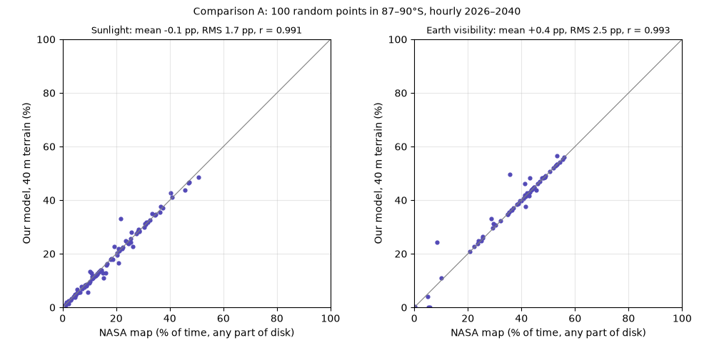

# validation.md — Comparison with NASA's published illumination maps

> **Review status: SIGNED OFF (2026-11-14).** Comparison A passes all criteria; the two comparison B site values that miss the criterion are explained by terrain resolution and steep local gradients (§9.2). Follow-ups noted: sensitivity study with NASA's alternative site maps, and a possible minimum mast height.

## 1. Purpose

P1–P3 and M2 showed the machinery is correct and self-consistent. This step checks it against an **independent, published result**: the LOLA team's average illumination and Earth-visibility maps of the south pole (Mazarico et al. 2011, updated 2016; PGDA product 69). If our pipeline and theirs agree where they should, and disagree only for documented reasons, the physics is validated.

**The tolerances in §6 are fixed before running**, so results can't be tuned to fit.

## 2. The reference data

From the products' own labels (`AVGVISIB_85S_060M_201608.LBL` and `…_EARTH.LBL`):

| Property | NASA's maps | Our model | Same? |
|---|---|---|---|
| Value | Fraction of hourly time steps when **any part** of the Sun's (or Earth's) disk is visible | Fraction of time steps when the body's **centre** is visible | **No**: handled in §3 |
| Period | "Lunar nutation cycle", hourly over 18.6 years (per PGDA page) | Hourly, any window within 2026–2040 | **No**: 15 years used, see §5 |
| Terrain | LOLA 60 m map (`LDEM_85S_060M`, 2016) | LOLA 5 m site maps + 40 m regional map (2021–2023) | **No**: tested directly in §4 |
| Observer height | Surface (no height given) | 0–20 m above ground | Use 0 m |
| Frame | MOON_ME of DE421 | MOON_ME of DE421 | Yes |
| Projection | Polar stereographic, 1,737.4 km sphere, 60 m pixels, 5058 × 5058 | Same projection and sphere | Yes |
| Coverage | 85–90°S, partial to 82.9°S | All four sites lie within 1.3° of the pole | Yes |

Files: `AVGVISIB_85S_060M_201608.IMG` (sunlight) and `AVGVISIB_85S_060M_201608_EARTH.IMG` (Earth visibility), 16-bit integers, value = number × 0.00004, from `https://imbrium.mit.edu/EXTRAS/ILLUMINATION/IMG/`. **51 MB each, about 102 MB in total**, plus two 4 KB labels.

## 3. Matching their definition: "any part of the disk"

For this comparison only, a body counts as visible when **any part of its disk** is above the horizon:

$$
\text{visible} \iff e + \rho > H(a),
\qquad
\rho = \arcsin\left(\frac{R_\text{body}}{d}\right)
$$

where $e$ and $a$ are the centre's elevation and azimuth, $d$ is its distance (from the sky grid), and $R_\text{body}$ is 696,000 km for the Sun or 6,371 km for the Earth:

| Body | Disk radius $\rho$ seen from the Moon |
|---|---|
| Sun | about 0.26–0.27° |
| Earth | about 0.90–1.02° |

Treating the horizon as flat across the disk's width is an approximation (the horizon can change within ±1° of azimuth), noted as a limit.

**This is a validation-only setting.** The app's own metrics keep the approved centre-point definition until the partial-disk extension (P1 in the plan) is designed and reviewed.

## 4. Two comparisons

**A. Method check, many points, same-resolution terrain.**
This isolates our *method* from terrain resolution. At **100 random points** spread over 87–90°S, run our ray casting using **only the 40 m regional map** (no 5 m detail), observer at 0 m, any-part-of-disk rule, hourly over 2026–2040. Compare with NASA's map value at the same point. The two terrain maps are similar in resolution (40 m vs 60 m), so a correct method should agree well across all 100 points.

**B. The four demo sites, full model.**
Run our full model (5 m near zone + 40 m far zone) at each site point, observer 0 m, any-part rule, 2026–2040, and compare with NASA's map. Here differences are *expected* from the 5 m terrain, which resolves nearby bumps the 60 m map smooths away. To show how much NASA's own values vary over short distances, report their **minimum and maximum within 120 m** of each site point, alongside the value at the point.

## 5. Choices that keep it fair

- **NASA's map is sampled with bilinear interpolation** at each point, using the label's projection.
- **Random points avoid the map edge and permanent shadow:** 87–90°S, at least 10 km from the pole (our pole guard), and only points NASA shows as lit at least 1% of the time (crater floors at 0% would agree trivially and inflate the statistics).
- **The random points use a fixed seed**, so the comparison is reproducible.
- **15 years instead of 18.6.** Our sky grid covers 2026–2040. I'll also report the year-to-year spread of our results, to show how much a shorter window can change them.

## 6. Pass criteria (proposed, fixed before running)

| Comparison | Measure | Proposed tolerance |
|---|---|---|
| A (100 points), sunlight | Mean difference (ours − NASA) | within ±3 percentage points |
| A, sunlight | Root-mean-square difference | ≤ 8 percentage points |
| A, sunlight | Correlation across points | ≥ 0.90 |
| A, Earth visibility | Same three measures | same tolerances |
| B (4 sites) | Difference at each site | Reported and explained; each site's value should lie within NASA's 120 m min–max range, or within ±10 percentage points of the value at the point |

**Why these numbers:** the terrain maps differ in version and resolution, the periods differ, and NASA's observer height isn't stated. Several percentage points of scatter is expected even with an identical method. A *systematic* offset beyond ±3 points, or poor correlation, would point to a real error in our method.

**If a criterion fails,** I'll investigate and report the cause before changing anything, and any fix goes through review like the M2 fixes.

## 7. What gets built

| Piece | Where |
|---|---|
| Download + checksum manifest | `data/raw/validation/` (gitignored), `data/manifests/validation.json` (committed) |
| Reader for NASA's PDS image + label projection | `pipeline/validate_illumination.py` |
| Any-part-of-disk visibility (validation only) | same script; reuses the M2 horizon and visibility code |
| Results, scatter plots, site table | `docs/physics/validation.md` §9 and `docs/physics/img/validation_*.png` |

No runtime code changes.

## 9. Results (2026-11-14)

**Run.** `python -m pipeline.validate_illumination` (about 4.5 minutes). The NASA maps (102 MB) are in `data/raw/validation/` with checksums in `data/manifests/validation.json`; the 100-point results are in `data/validation/comparison_a.csv`.

**Orientation check of NASA's maps.** GDAL reads the PDS maps with exactly our projection, sphere and 60 m pixels. Because polar PDS products have a history of flipped-axis conventions, all eight flips and rotations were tested against our own terrain. Only the orientation as read correlates with local relative height (+0.32); all seven others give about 0.00. The georeferencing is therefore correct as read.

### 9.1 Comparison A: method check, 100 random points (all criteria PASS)

| Quantity | Mean difference (ours − NASA) | RMS difference | Correlation | Tolerance | Result |
|---|---|---|---|---|---|
| Sunlight | −0.10 pp | 1.66 pp | 0.991 | ±3 pp / ≤ 8 pp / ≥ 0.90 | **PASS** |
| Earth visibility | +0.37 pp | 2.47 pp | 0.993 | ±3 pp / ≤ 8 pp / ≥ 0.90 | **PASS** |

The points span 1–51% sunlight and 0–56% Earth visibility in NASA's maps. With comparable terrain (our 40 m vs their 60 m), our pipeline reproduces NASA's published results with essentially **no systematic offset**, an RMS scatter of 2–2.5 percentage points, and correlations above 0.99. The scatter is consistent with the different terrain versions and periods (§2).

*Each dot is one random point in 87–90°S; the grey line is perfect agreement.*

### 9.2 Comparison B: the four demo sites, full model

Criterion: ours within NASA's 120 m min–max range, **or** within ±10 pp of NASA's value at the point.

| Site | Sunlight: ours | NASA at point | NASA within 120 m | Meets criterion? | Earth: ours | NASA at point | NASA within 120 m | Meets criterion? |
|---|---|---|---|---|---|---|---|---|
| 01 Connecting ridge | 40.2% | 41.0% | 22.2–76.9% | yes | 29.7% | 37.2% | 18.8–57.2% | yes |
| 04 Shackleton rim | 85.4% | 62.6% | 0.0–85.2% | **no** (0.2 pp above the range) | 56.4% | 47.6% | 15.7–55.0% | yes (±10 pp) |
| 07 Peak near Shackleton | 31.4% | 44.2% | 17.0–86.0% | yes (in range) | 49.8% | 50.2% | 44.2–60.6% | yes |
| 11 de Gerlache rim | 28.6% | 54.0% | 33.1–66.1% | **no** | 51.2% | 61.2% | 54.3–61.3% | yes (−10.0 pp) |

Year-to-year spread of our yearly sunlight values at these sites: 2.3–3.8 pp, so the 15- vs 18.6-year difference cannot explain gaps of 20+ pp.

**Two site values miss the criterion, so they were investigated before drawing any conclusion.** The diagnostic reruns each site point with our method on **40 m terrain only** (the comparison A setup), which separates the method from the terrain detail:

| Site | Sun: NASA | Ours, 40 m only | Ours, full 5 m model | Earth: NASA | Ours, 40 m only | Ours, full 5 m model |
|---|---|---|---|---|---|---|
| 01 | 41.0% | 41.1% | 40.2% | 37.2% | 40.4% | 29.7% |
| 04 | 62.6% | 78.5% | 85.4% | 47.6% | 55.4% | 56.4% |
| 07 | 44.2% | 59.0% | 31.4% | 50.2% | 54.2% | 49.8% |
| 11 | 54.0% | 48.7% | 28.6% | 61.2% | 61.3% | 51.2% |

**Diagnosis:**
1. **Site 11: the 5 m terrain is the cause.** On 40 m terrain our method gives 48.7% against NASA's 54.0%, a normal comparison-A-sized gap. Adding the 5 m detail drops it to 28.6%: nearby bumps that 40 m and 60 m maps smooth away block the low Sun from a ground-level observer.
2. **Site 04: a sharp rim crest.** NASA's own values range from **0% to 85.2% within 120 m** here, from the shadowed inner wall to the crest. Our point is the crest's highest 5 m pixel, while NASA's value at that location blends 60 m pixels across the rim. Our 85.4% essentially equals NASA's best nearby value (85.2%).
3. **Site 07: a sharp peak.** NASA's values range 17–86% within 120 m, so the comparison is very sensitive to exact location and resolution even on coarse terrain (59.0% vs 44.2%). The full model's 31.4% lies within NASA's range.
4. **Site 01** agrees closely on both terrains.

**Conclusion.** The method is validated: comparison A shows no systematic error and very close agreement where terrain resolution is comparable. The site-level differences come from **terrain resolution near the observer and steep local gradients**, which the plan anticipated, not from an error in the method. No code changes are proposed.

**An important caution this surfaced.** At a **ground-level** observer, the 5 m terrain within the first few hundred metres can change sunlight by 20–28 percentage points (Sites 07 and 11). That terrain is about 90% interpolated, with 0.3–0.5 m height uncertainty. A 0.3 m error at 30 m away is a 0.6° horizon error, larger than the Sun's daily elevation swing near the pole. So **results for very low observer heights are the least certain**. The tool's realistic heights (masts of a few metres) are less sensitive, but this supports two follow-ups: a sensitivity study using NASA's 100 alternative versions of each site map, and possibly a minimum mast height in the API.

## 8. Review sign-off

| Stage | Reviewer | Date | Decision / comments |
|---|---|---|---|
| Approach (§3–§7), tolerances (§6), download of ~102 MB (§2) | Randy Moore | 2026-11-14 | Approved |
| Results and evidence, incl. the comparison B diagnosis (§9.2) | Randy Moore | 2026-11-14 | Signed off; no code changes |
